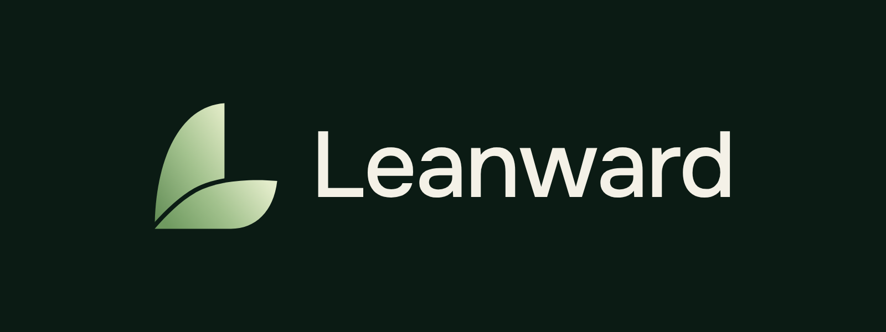

# Leanward brand

The rules for the Leanward logo, colors and type. The app's in-product colors (Phase Light and the ACC-6 palettes) are set in PRD §9. This page covers the brand itself.

## Idea

Two leaves form an **L**. The upper leaf rises; the lower one points forward and up: *lean*, and *-ward* (moving toward a goal). It suggests real food and steady growth without promising a body shape.

**Watch-out:** leaves can read as "vegan" or "eco". Leanward is about macros, phases and body composition, so the words and pictures around the logo lead with phases, protein and progress, and show ordinary food, protein included. The logo never appears on its own next to plant-only food imagery.

## Logo files

| File | Use |
|---|---|
| `mark.svg` | Main mark, for dark backgrounds, 48 px and up |
| `mark-light.svg` | Deeper greens, for light or cream backgrounds |
| `mark-small.svg` | Flat colors and a wider gap, for anything under 48 px (the gradient and the thin gap blur at small sizes) |
| `icon-1024.png` | Master app icon (square, no rounded corners; iOS and Android round it themselves) |
| `lockup-dark.png`, `lockup-light.png` | Mark + wordmark, for docs, the README and social posts |
| `../../app/icons/favicon.svg` | Browser tab icon (small mark on a rounded dark square) |

The vector shapes are hand-drawn from the owner's concept sheet (2026-11-03). If a designer redraws them, replace these files and re-export the PNGs in `app/icons/`.

## Rules

- **No ® symbol.** ® may only be used once the US trademark is registered. Until the trademark checks (decisions log) are done, use no symbol; ™ is allowed once we decide to claim the name.
- Clear space around the mark: at least half the mark's width on every side.
- Don't recolor, rotate, outline, add shadows, or put the mark on a busy photo.
- The mark stays brand green everywhere, including the app icon. It does **not** change with the user's phase or palette; only the in-app glow does.

## Colors

| Name | Hex | Use |
|---|---|---|
| Forest | `#0B1B14` | Icon and marketing background |
| Leaf | `#A3C28E` | The mark; brand accent in marketing |
| Cream | `#F4F1E7` | Wordmark on dark; light backgrounds |
| Charcoal | `#2B2F2D` | Secondary surfaces in marketing |

These are brand colors, not app UI colors. Inside the app, the Phase Light palettes apply (PRD §9, ACC-6).

## Type

- **Onest** everywhere, already bundled in the app (`app/fonts/`, SIL Open Font License). The concept sheet showed Inter; Onest is kept so the wordmark, app and marketing use one family and nothing extra is downloaded.
- Wordmark: "Leanward", Onest Medium (500), letter-spacing −2 %, Cream on dark or Forest on light.

## Voice

Calm, plain and specific. Explain the numbers, never shame. One line we already use: **"Calories and macros, guided by the phase you're in."**
